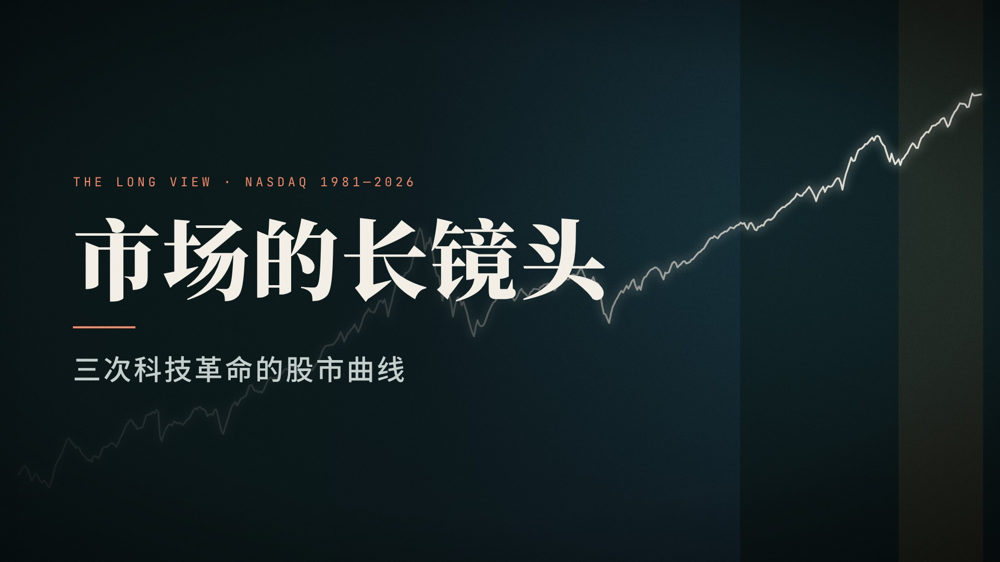

# 视频工作室 · Video Studio

用代码做视频。这里每支视频都是一个 [Remotion](https://www.remotion.dev)（React + TypeScript）组件：
文案、数据、镜头、配乐都在仓库里，可以改、可以复现、可以一键重新渲染。

## 作品



| 视频 | 时长 | 说明 |
|------|------|------|
| **市场的长镜头｜三次科技革命的股市曲线**<br>`TechCycles` · [`exports/tech-cycles.mp4`](exports/tech-cycles.mp4) | 3:12 · 1080p | 把 PC、互联网、AI 三次科技革命放进同一个镜头：技术可以长期成功，资本也可能短期定价错误。分镜见 [`materials/tech-cycles/storyboard.md`](materials/tech-cycles/storyboard.md) |

## 快速开始

```bash
npm install
npm run studio        # 打开 Remotion Studio，实时预览、拖时间轴
npm run render        # 渲染成片 → out/TechCycles.mp4
```

导出静帧检查画面（比整片渲染快得多）：

```bash
node scripts/still.mjs TechCycles out/stills 0 900 2400 --scale=0.5
```

> 在没有 Remotion 自带浏览器的环境（云端、CI）里，用环境变量指定本地 Chromium：
> `export REMOTION_BROWSER_EXECUTABLE=/path/to/chrome-headless-shell`

配乐与贴图由 Python 脚本生成（需要 `ffmpeg`）：

```bash
pip install -r scripts/requirements.txt
npm run audio                         # 按 timeline.json 生成 public/tech-cycles/score.m4a
python3 -I scripts/make_textures.py   # 胶片颗粒、雾气贴图
```

## 目录

```
src/
  Root.tsx                 所有视频在这里注册（每支一个 Composition）
  lib/                     通用设计系统，新视频直接复用
    theme.ts               颜色、字体、画面尺寸
    fonts.ts               中文字体（Noto Serif/Sans SC）+ 渲染前预加载
    motion.ts              缓动、进度、噪声
    components.tsx         逐字浮现、打字机、眉标、数字标签、颗粒、暗角、抖动……
    chart.tsx              SVG 图表原语：比例尺、逐段绘制折线、网格、标注、斜线阴影
  videos/
    tech-cycles/           《市场的长镜头》
      copy.ts              全部文案（改字只改这里）
      timeline.json        场景时长与节拍点（画面和配乐共用）
      data.ts              数据与素材中的关键数字
      data/                纳斯达克月度序列
      scenes/              每个场景一个组件
      TechCycles.tsx       串联场景 + 配乐
public/                    静态资源（配乐、贴图）
materials/<视频>/          原始素材、分镜脚本
scripts/                   渲染、静帧、配乐、数据处理脚本
exports/                   定稿成片
```

## 做一支新视频

1. **素材**：放进 `materials/<slug>/source/`，在同目录写 `storyboard.md`（核心意思、场景表、关键数字）。
2. **文案与时间轴**：在 `src/videos/<slug>/` 新建 `copy.ts`、`timeline.json`（照抄 tech-cycles 的结构）。
3. **场景**：每个场景一个组件，用 `src/lib` 里的组件和 `beats()` 读取节拍点。
4. **注册**：在 `src/Root.tsx` 加一个 `<Composition>`。
5. **配乐**：复制 `scripts/make_audio.py`，改 `score()` 里的编排；节拍点从 `timeline.json` 读取，画面改了时长重跑一次即可对齐。
6. **检查**：先用 `scripts/still.mjs` 导几帧看排版，再整片渲染；定稿复制到 `exports/`。

竖版（1080×1920）只要再注册一个不同尺寸的 Composition，并为场景提供竖版排版。

## 关于《市场的长镜头》的数据

- 原素材只有图表 PNG，没有数据表。`scripts/digitize_nasdaq.py` 对「一张图看 45 年」那张对数坐标图做像素级数字化，再用素材中写明的数字（以及与之相符的公开月末收盘价）作锚点校正，误差约 1%，只用于驱动曲线动画。
- 画面上出现的数字（5,048.62、1,114.11、−78%、+284% / +130% / +54%、26,424.82 等）全部取自素材，而不是数字化结果。
- 数据：FRED NASDAQCOM、Yahoo Finance；名义价格，不含通胀、分红、税费；截至 2026-10-20。历史数据不构成投资建议。

## 许可

- **Remotion** 使用自有许可：个人、3 人及以下的营利组织、非营利组织可免费使用（含商用）；更大规模的营利组织需要购买 [Company License](https://www.remotion.pro/license)。
- 字体：Noto Serif SC、Noto Sans SC、JetBrains Mono，均为 SIL Open Font License。
- 配乐与音效由 `scripts/make_audio.py` 合成，无第三方采样。
