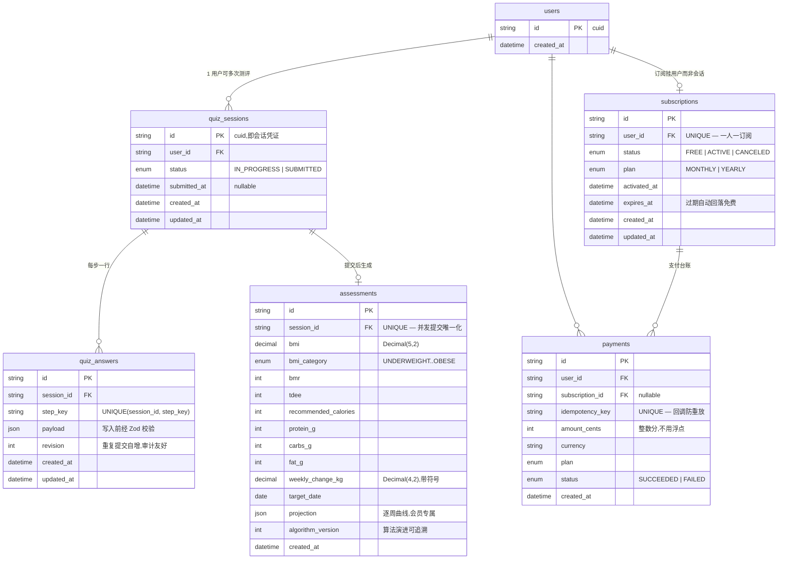

# 轻盈计划 · 健康测评系统

[](https://github.com/ihoooohi/FlowCE/actions/workflows/health-quiz-ci.yml)

一个 BetterMe 风格的健康测评漏斗(quiz funnel)的**核心后端架构** + 可演示前端:

- **分步保存 / 进度恢复** — 每答一步即持久化,关闭页面回来自动续答
- **服务端健康评估算法** — BMI、BMR/TDEE、每日热量建议、三大营养素、目标达成日期与逐周体重预测曲线
- **订阅鉴权与差异化返回** — 非会员拿到脱敏视图(受保护字段整体缺失而非置空),会员拿到完整计划
- **模拟支付回调闭环** — `/api/v1/pay` 幂等回调,支付后同一结果接口返回从"脱敏"变为"完整"
- **104 个自动化测试** — 单元(算法/校验边界)+ 集成(真实 Postgres 上跑真实路由)+ 端到端(漏斗→脱敏→支付→完整)

技术栈:**Next.js 15 (App Router) + TypeScript + Prisma 6 + PostgreSQL + Zod + Vitest**,CI 为 GitHub Actions(Postgres service 容器)。

---

## 目录

- [快速启动](#快速启动)
- [一键运行测试](#一键运行测试)
- [测试覆盖了什么、为什么](#测试覆盖了什么为什么)
- [API 文档](#api-文档)
- [/pay 可重放调用(cURL)](#pay-可重放调用curl)
- [已支付测试 sessionId(付费前后对比)](#已支付测试-sessionid付费前后对比)
- [数据库 Schema 图](#数据库-schema-图)
- [健康评估算法](#健康评估算法)
- [关键工程决策](#关键工程决策)
- [部署到公网](#部署到公网)
- [AI 使用复盘](#ai-使用复盘)

---

## 快速启动

前置:Node.js ≥ 20、一个 PostgreSQL 实例(本地 / Supabase / Neon 均可)。

```bash
cd health-quiz
npm install

# 配置数据库连接
cp .env.example .env        # 修改 DATABASE_URL / TEST_DATABASE_URL

# 建表 + 生成客户端
npx prisma migrate deploy
npx prisma generate

# 灌入演示数据(demo-paid-0001 / demo-free-0001,可重复执行)
npm run db:seed

# 启动
npm run dev                  # 或 npm run build && npm start
```

打开 http://localhost:3000 即可从落地页一路走完 funnel → 付费墙 → 模拟支付 → 完整报告。

## 一键运行测试

```bash
npm test
```

要求 `.env` 中的 `TEST_DATABASE_URL` 指向一个**可丢弃的** Postgres 库(套件会在每个用例间 TRUNCATE 全部表)。测试启动时自动对测试库执行 `prisma migrate deploy`,无需手动建表。

CI:每次 push/PR 触发 [`health-quiz-ci.yml`](../.github/workflows/health-quiz-ci.yml) —— Postgres 16 service 容器 + 类型检查 + 全量测试 + 生产构建,通过状态见顶部徽章。

## 测试覆盖了什么、为什么

**104 个用例,5 个文件。** 集成测试不 mock 数据库、不 mock 业务层 —— 直接以 Web `Request` 调用真实的 Next.js 路由处理器,写真实 Postgres,与生产流量走完全相同的代码路径。

| 文件 | 覆盖内容 | 为什么是这些 |
| --- | --- | --- |
| `tests/unit/health.test.ts`(35) | BMI/BMR/TDEE 公式精确值;WHO 分类边界(18.5/25/30 恰好落界);热量下限钳制后"诚实降速";安全摄入内不可达目标 → 显式报错;增肌/保持分支;超长跨度曲线截断但日期精确;NaN/Infinity/0/负数/非法时钟 → 抛错 | 算法是付费内容的来源,错一个数字用户就拿到错误的健康建议;边界(恰好在界上、被钳制、不可达)是手工点检最容易漏的 |
| `tests/unit/quiz-schema.test.ts`(35) | 每步 schema 的枚举封闭性;年龄/身高/体重的上下界与恰好压界;非整数年龄、数字字符串、SQL 注入形态字符串、null/布尔/数组载荷、多余字段(strict);"身高体重组合不合理"(当前 BMI 越窗)与"目标体重不安全"(目标 BMI < 15 / > 60);跨字段目标-方向矛盾 | 题目明确要求"挡住非法数值注入与越界输入";strict + finite 是防注入的第一道闸,必须有测试钉死 |
| `tests/integration/funnel.test.ts`(20) | 分步保存→进度恢复;中断后恢复;**乱序**提交(activity 先于 gender);**重复**提交收敛为一行(revision 递增);**并发**写同一步/不同步无 500 且单行;422 时零持久化;提交缺步列出缺什么;提交后答案冻结(409);重复提交幂等;**并发提交只产生一份评估** | 这是第一、二阶段的核心验收标准,并发与乱序是"本地点了一下"永远测不出来的 |
| `tests/integration/result-access.test.ts`(9) | 未提交查结果 → 409;免费视图**所有**受保护字段以键形式缺失(逐个断言);会员完整视图;**过期订阅回落为免费**;/pay 的入参校验(缺 sessionId、未知 plan、多余字段、坏 JSON) | 鉴权差异化的本质是"非会员拿不到被保护字段",断言的是字段缺失而不是值为空 |
| `tests/integration/pay-e2e.test.ts`(6) | 完整端到端:建会话→4 步→提交→**脱敏**→`/pay`→**完整**;幂等键重放不重复扣款不重复延期;新键续费从当前到期日**顺延**;幂等键被他人占用 → 422;先付费后提交也能解锁;并发支付收敛为一个一致订阅 | 题目要求的"/pay 回调后状态变更 + 脱敏→完整的端到端验证",外加真实支付系统必踩的幂等/并发坑 |

**暂未覆盖及原因:**

- **浏览器层 UI 测试(Playwright)** — 题目定位"UI 不在考查范围内";所有业务行为已在 API 层端到端覆盖,UI 只是这些接口的消费者。开发中做过一次 Playwright 手工走查(含刷新后进度恢复)确认可用。
- **负载/压测** — 并发正确性已用 `Promise.all` 竞态用例覆盖(唯一约束 + P2002 重试收敛);吞吐量测试超出 3 天挑战范围。
- **真实支付网关签名校验** — `/pay` 是模拟回调,签名验证属于接入真实网关(Stripe/微信支付)时的工作,幂等与重放语义已按真实网关标准实现并测试。

## API 文档

统一响应信封:成功 `{ "data": ... }`,失败 `{ "error": { "code", "message", "details?" } }`。

| 方法 | 路径 | 说明 |
| --- | --- | --- |
| `POST` | `/api/v1/sessions` | 创建匿名用户 + 测评会话,返回 `sessionId`(不可猜测的 cuid,即会话凭证) |
| `GET` | `/api/v1/sessions/:sessionId` | **进度恢复**:已答步骤、下一步、全部已存答案 |
| `PUT` | `/api/v1/sessions/:sessionId/answers/:stepKey` | **分步保存**(幂等替换)。`stepKey ∈ gender / goal / body / activity` |
| `POST` | `/api/v1/sessions/:sessionId/submit` | 提交:完整性 + 跨字段校验 → 服务端计算 → 持久化。幂等 |
| `GET` | `/api/v1/sessions/:sessionId/result` | **鉴权差异化返回**:free 脱敏 / premium 完整(均为 200,tier 是数据) |
| `POST` | `/api/v1/pay` | **模拟支付回调**:激活/续期订阅,幂等键防重放 |
| `GET` | `/api/v1/health` | 存活 + 数据库连通性探针 |

### 步骤载荷(全部 strict:多余字段即 422)

```jsonc
PUT /answers/gender    { "gender": "female" | "male" | "other" }
PUT /answers/goal      { "goal": "lose_weight" | "maintain" | "gain_muscle" }
PUT /answers/body      { "age": 16..100(整数), "heightCm": 120..230, "weightKg": 30..300, "targetWeightKg": 30..300 }
PUT /answers/activity  { "activityLevel": "sedentary" | "light" | "moderate" | "active" | "very_active" }
```

`body` 步骤额外拒绝:身高体重组合不合理(当前 BMI 不在 10–80)、目标体重不安全(目标 BMI 不在 15–60)。
提交时跨字段校验:减重目标要求目标体重严格低于当前;增肌要求不低于当前;保持要求与当前一致(±0.5kg)。

### 错误码

| HTTP | code | 场景 |
| --- | --- | --- |
| 400 | `INVALID_JSON` | 请求体不是合法 JSON |
| 404 | `SESSION_NOT_FOUND` / `UNKNOWN_STEP` | 未知会话 / 未知步骤 |
| 409 | `SESSION_ALREADY_SUBMITTED` | 提交后再改答案 |
| 409 | `SESSION_NOT_SUBMITTED` | 未提交就查结果 |
| 422 | `VALIDATION_ERROR` | 字段/跨字段校验失败(`details.issues` 逐字段) |
| 422 | `MISSING_STEPS` | 提交时缺步(`details.missingSteps`) |
| 422 | `UNREACHABLE_TARGET` | 安全摄入下限内无法达成目标 |
| 422 | `PAYMENT_INVALID` | 幂等键被其他用户占用 |

### 差异化返回示例

`GET /result`,**非会员**(受保护字段整体缺失,`locked` 明示锁了什么):

```json
{
  "data": {
    "tier": "free",
    "summary": { "bmi": 27.8, "bmiCategory": "OVERWEIGHT" },
    "preview": { "targetMonth": "2027-01", "headline": "你的专属计划已生成" },
    "locked": ["bmr", "tdee", "recommendedCalories", "macros", "weeklyChangeKg", "targetDate", "weeksToTarget", "projection"],
    "upgrade": { "required": true, "payEndpoint": "/api/v1/pay", "plans": [ ... ] }
  }
}
```

同一接口,**会员**:

```json
{
  "data": {
    "tier": "premium",
    "summary": { "bmi": 27.8, "bmiCategory": "OVERWEIGHT" },
    "plan": {
      "bmr": 1828, "tdee": 2833, "recommendedCalories": 2333,
      "macros": { "proteinG": 175, "carbsG": 233, "fatG": 78 },
      "weeklyChangeKg": -0.45, "targetDate": "2027-01-10", "weeksToTarget": 23,
      "projection": [ { "week": 0, "date": "2026-08-07", "weightKg": 88 }, ... ]
    }
  }
}
```

## /pay 可重放调用(cURL)

```bash
BASE=http://localhost:3000   # 部署后替换为线上域名

# 1) 从头走一遍漏斗(可整段复制执行)
SID=$(curl -s -X POST $BASE/api/v1/sessions | python3 -c "import sys,json;print(json.load(sys.stdin)['data']['sessionId'])")
curl -s -X PUT $BASE/api/v1/sessions/$SID/answers/gender   -H 'content-type: application/json' -d '{"gender":"male"}'
curl -s -X PUT $BASE/api/v1/sessions/$SID/answers/goal     -H 'content-type: application/json' -d '{"goal":"lose_weight"}'
curl -s -X PUT $BASE/api/v1/sessions/$SID/answers/body     -H 'content-type: application/json' -d '{"age":34,"heightCm":178,"weightKg":88,"targetWeightKg":78}'
curl -s -X PUT $BASE/api/v1/sessions/$SID/answers/activity -H 'content-type: application/json' -d '{"activityLevel":"moderate"}'
curl -s -X POST $BASE/api/v1/sessions/$SID/submit

# 2) 付费前:脱敏返回
curl -s $BASE/api/v1/sessions/$SID/result

# 3) 模拟支付回调(幂等:重复执行同一条命令返回 replayed=true,不重复扣款)
curl -s -X POST $BASE/api/v1/pay \
  -H 'content-type: application/json' \
  -d "{\"sessionId\":\"$SID\",\"plan\":\"MONTHLY\",\"idempotencyKey\":\"demo-replay-001\"}"

# 4) 付费后:同一接口,完整返回
curl -s $BASE/api/v1/sessions/$SID/result
```

## 已支付测试 sessionId(付费前后对比)

`npm run db:seed` 后(线上环境已预置),两个固定会话可直接对比差异化返回:

| sessionId | 状态 | 用途 |
| --- | --- | --- |
| `demo-paid-0001` | 已提交 + **已付费**(年度会员) | `GET /api/v1/sessions/demo-paid-0001/result` → 完整计划 |
| `demo-free-0001` | 已提交 + 未付费 | `GET /api/v1/sessions/demo-free-0001/result` → 脱敏视图 |

```bash
curl -s $BASE/api/v1/sessions/demo-paid-0001/result   # tier: premium,含 projection
curl -s $BASE/api/v1/sessions/demo-free-0001/result   # tier: free,受保护字段缺失
```

## 数据库 Schema 图



**建模要点**:订阅挂在 `users` 而非 `quiz_sessions` 上 —— 用户重测 N 次仍是同一个会员身份;`quiz_answers` 用 `(session_id, step_key)` 唯一约束把"乱序/重复/并发提交"在数据库层收敛成一行;`payments` 是只增台账(幂等键唯一),订阅状态是台账的投影;金额存整数分、体重存 `Decimal` 而非 float。

## 健康评估算法

全部在服务端计算(`src/lib/health.ts`),纯函数 + 注入时钟,同输入必同输出:

| 指标 | 公式 |
| --- | --- |
| BMI | `kg / m²`,WHO 四档分类 |
| BMR | Mifflin-St Jeor(`other` 取男女公式均值) |
| TDEE | `BMR × 活动系数(1.2–1.9)` |
| 建议热量 | 减重 `TDEE−500`,增肌 `TDEE+300`,保持 `TDEE`;**下限钳制**:女性/其他 1200、男性 1500 kcal |
| 每周变化 | `实际热量差 × 7 ÷ 7700 kcal/kg` —— 被钳制后用真实缺口计算,预测**诚实降速** |
| 达成日期 | 体重差 ÷ 日均变化,按天上取整;下限吞掉全部缺口时**拒绝编造日期**(422 `UNREACHABLE_TARGET`) |
| 预测曲线 | 逐周采样,恰好收敛到目标体重;图表最多 104 点,日期不受截断影响 |

## 关键工程决策

- **鉴权模型**:匿名漏斗场景,`sessionId`(cuid,约 2¹²⁶ 空间)本身即 bearer 凭证 —— 与 BetterMe 一致的"先测评后注册"模式,无需账号体系即可闭环;接入真实账号体系时只需在 `users` 上挂登录凭证,数据模型无需变动。
- **幂等无处不在**:步骤保存是幂等 PUT;提交幂等(重复返回同一评估);支付幂等(键重放返回原结果)。所有并发竞态由数据库唯一约束兜底,P2002 捕获后收敛重试 —— 测试用 `Promise.all` 直接验证。
- **脱敏 = 字段缺失**:免费视图不是把值置 null,而是序列化层整体不输出受保护字段,响应里无从抓取;`locked` 数组显式告诉前端锁了什么,驱动付费墙 UI。
- **验证三层**:Zod strict(类型/范围/多余字段/NaN/Infinity)→ 跨字段规则(目标与方向矛盾)→ 算法防御性断言(深层防线,防带病数据)。

## 部署到公网

任何 Node 平台皆可,推荐 **Vercel + Supabase/Neon**(免费档足够演示):

1. 在 [Supabase](https://supabase.com) / [Neon](https://neon.tech) 建一个 Postgres,拿到连接串。
2. Vercel 导入本仓库,**Root Directory 选 `health-quiz`**,环境变量设 `DATABASE_URL`。
3. 首次部署前在本地对线上库执行:
   ```bash
   DATABASE_URL="<线上连接串>" npx prisma migrate deploy
   DATABASE_URL="<线上连接串>" npm run db:seed   # 预置 demo-paid-0001 / demo-free-0001
   ```
4. 部署完成后,README 顶部替换为线上 URL,即可在线上跑通 funnel + 模拟支付全流程。

## AI 使用复盘

见 [`docs/AI_COLLABORATION.md`](docs/AI_COLLABORATION.md) —— 包括如何用 AI 做数据库建模、生成边界测试用例,以及一次**否决 AI 方案**的具体记录。
